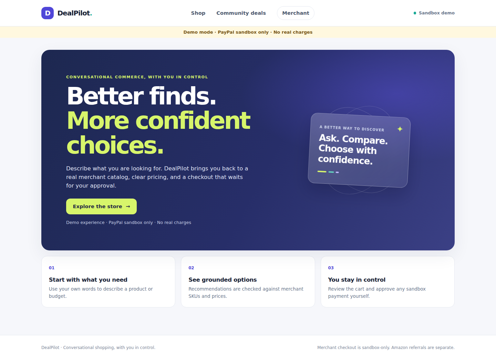
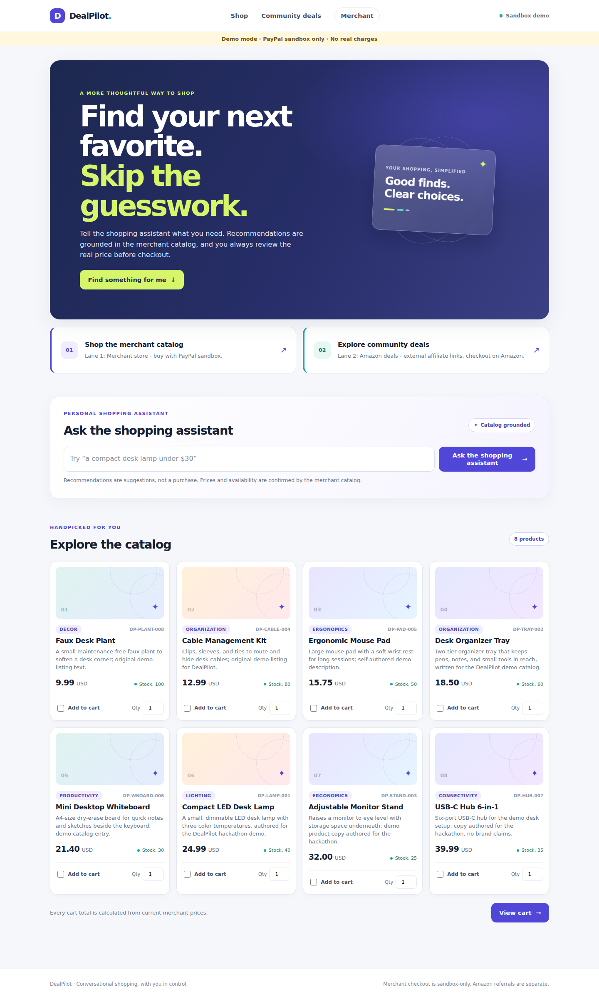

# DealPilotAI — AI-Powered Conversational Commerce with PayPal

DealPilotAI is a Flask application that combines natural-language product discovery with a merchant-owned catalog, cart quoting, and a PayPal Orders v2 sandbox checkout. A separate legacy lane supports Telegram deal discovery and Amazon affiliate referrals.

**Release status (assessed 2026-11-05): not verified for hackathon submission.** The current uncommitted working tree passes 152 tests at 76% targeted coverage, including a mocked desktop/mobile browser journey. The latest real AI request failed, no buyer-approved PayPal capture is evidenced, and the latest GitHub Actions run failed on earlier source. The verified source is HEAD `f758a163f2683d56c2c90bc85bcb9a653977c144` plus uncommitted backend, storefront, security-test, screenshot, and evidence updates. See [the release gate matrix](docs/release/RELEASE_GATE_MATRIX.md).

## Problem and solution

Shopping discovery is often disconnected from checkout. DealPilotAI demonstrates a conversational path from a request to catalog-grounded recommendations and a cart, while keeping merchant-authorized products and Amazon affiliate referrals in distinct flows. A human must approve PayPal sandbox payment; the AI cannot authorize or capture a payment.

**Intended users:** shoppers looking for product options based on a natural-language request or budget, and small merchants evaluating a controlled catalog-to-checkout workflow.

## Current features

- Merchant catalog with server-authoritative SKU, price, currency, active status, and stock.
- AI recommendation service with strict Pydantic validation, catalog grounding, prompt-injection boundaries, and a clearly labeled deterministic fallback.
- Decimal cart totals, quote expiration, ownership checks, and configured cart limits.
- PayPal Orders v2 client restricted to sandbox, with request idempotency and typed ambiguous-error handling.
- Durable commerce storage and webhook signature-verification/retry code paths.
- Flask shop, cart, checkout return, receipt, and merchant routes.
- Responsive commerce storefront and CSRF-protected merchant browser login with expiring sessions.
- Separate Telegram/Amazon affiliate lane; an affiliate referral does not use this app's PayPal checkout.

These are implemented capabilities, not claims that external live gates have passed. See the [test report](docs/release/TEST_REPORT.md) and [remaining blockers](docs/release/REMAINING_BLOCKERS.md).

## Screenshots and demo

The following are genuine screenshots of the local application running in offline demo mode. They show the UI and merchant catalog, not live AI inference or PayPal transactions.





No hosted demo or public demo video is currently available. Do not use mock payment states as evidence. The [demo runbook](docs/DEMO_RUNBOOK.md) describes the recording sequence and identifies the still-required live steps.

## Architecture

```text
Shopper -> Flask shop -> AIShoppingService -> merchant catalog
                         |                    (SKU/price re-grounding)
                         v
                    cart quote -> CheckoutService -> PayPal Orders v2 sandbox
                                      |                    |
                                      v                    v
                              durable storage       buyer approval
                                      ^
                                      |
                           verified webhook + retry

Telegram deal lane -> Amazon affiliate referral -> Amazon
```

The PayPal checkout is only for the separate merchant-owned catalog. Amazon affiliate links send buyers to Amazon and are not processed as PayPal orders.

## AI provider

The provider is selected with `AI_PROVIDER=openai` or `AI_PROVIDER=featherless`; provider credentials are `OPENAI_API_KEY` and `FEATHERLESS_API_KEY`. `AI_MODEL` selects the model. The current live attempt used Featherless and `Qwen/Qwen3.8-27B`, but returned an empty completion; the smoke test correctly reported `fallback=true`. The provider's default model was also rejected with a permission error. Real inference is therefore **not verified**. Check API-key status, model entitlement, and JSON-mode support before claiming an AI pass. See [AI live evidence](docs/release/AI_LIVE_EVIDENCE.md).

## PayPal sandbox

The integration uses PayPal Orders v2 and refuses live PayPal endpoints. A historical read-only sandbox OAuth probe succeeded on 2026-11-02; it was not repeated because credentials were identified for rotation. No buyer approval, capture ID, receipt-after-restart, or real signed webhook is evidenced. See [PayPal evidence](docs/release/PAYPAL_SANDBOX_EVIDENCE.md) and [webhook evidence](docs/release/WEBHOOK_EVIDENCE.md).

## Requirements and installation

Python 3.11 or newer is required by the application. The current clean test environment used Python 3.14.2.

```bash
git clone https://github.com/RafalW3bCraft/DealPilotAI.git
cd DealPilotAI
python3 -m venv .venv
. .venv/bin/activate
python -m pip install -r requirements-dev.txt
python -m playwright install --with-deps chromium
cp .env.example .env
```

The checked-in `.env.example` is an offline-demo profile. It enables the catalog routes, but contains no PayPal or AI credentials; checkout cannot create a PayPal order until sandbox credentials are configured. Its Flask secret is demo-only and must not be used for a public deployment.

Start the web application:

```bash
python main.py web
```

Open `http://127.0.0.1:5000/shop`. To run diagnostics:

```bash
python scripts/config_check.py
python scripts/ai_smoke.py
python scripts/ai_release_smoke.py
```

`ai_smoke.py` requires valid provider access and exits nonzero when the result falls back. `ai_release_smoke.py` runs English, Hindi, budget, multi-item cart, unsupported-product, schema, grounding, and malicious-catalog scenarios against the real configured provider; it never invokes checkout. Never commit `.env`; provide secrets through an approved secret manager in hosted environments.

## Environment and profiles

Required configuration is documented in [.env.example](.env.example). For a real sandbox flow, set `DEMO_MODE=false`, a strong `FLASK_SECRET_KEY`, `PREFERRED_URL_SCHEME=https` when served behind TLS, `PAYPAL_ENVIRONMENT=sandbox`, `ENABLE_MERCHANT_CHECKOUT=true`, durable `COMMERCE_DATABASE_URL`, PayPal sandbox client ID and secret, webhook ID, and the intended AI provider plus key/model. Keep `ENABLE_EXTERNAL_AFFILIATE=false` unless an affiliate tag and compliant referral flow are intentionally configured. `scripts/config_check.py --online` performs a read-only PayPal OAuth probe; it does not create an order or capture a payment.

Commerce schema initialization is managed by `CommerceStorage`; the PostgreSQL schema reference is [migrations/001_commerce.sql](migrations/001_commerce.sql). Use PostgreSQL for shared/deployed payment data. Local SQLite is for development only. Payment records must not use in-memory storage.

## Sandbox setup and webhook configuration

1. Create a PayPal developer sandbox REST app and sandbox buyer account.
2. Put the sandbox client ID/secret in local environment variables, never in source control.
3. Set `COMMERCE_DATABASE_URL` to a durable database and `FLASK_SECRET_KEY` to a strong random value.
4. Configure the webhook endpoint exposed by the app and copy its sandbox webhook ID to `PAYPAL_WEBHOOK_ID`.
5. Subscribe to the order-approved, approval-reversed, and capture pending/completed/denied events.
6. Run `python scripts/config_check.py --online` and verify the report without sharing credentials.
7. Complete the real buyer approval in the sandbox UI, then inspect the persisted receipt and merchant dashboard. Do not claim a capture until the returned capture ID and status are independently verified.

The recurring execution of `scripts/retry_paypal_webhooks.py` is not configured in a deployment yet. See [the webhook evidence](docs/release/WEBHOOK_EVIDENCE.md).

## Tests and checks

Use the isolated development dependencies:

```bash
python -m compileall -q .
python -m pip check
python -m ruff check .
python -m pip_audit -r requirements.lock
python -m playwright install --with-deps chromium
python -m pytest -q
python -m pytest --cov=ai --cov=commerce --cov=paypal_checkout --cov=web --cov-report=term-missing
```

The current isolated local run reports 152 passed, 0 failed, 0 skipped, and 76% targeted coverage. A mocked Playwright journey passes on desktop and mobile and tests merchant browser authentication and safe AI text rendering; it is not live AI or PayPal evidence. Public GitHub Actions run [41413708891](https://github.com/RafalW3bCraft/DealPilotAI/actions/runs/41413708891) failed on earlier source, and no successful run exists for the corrected working tree. `ruff check .` uses the explicit correctness rule set in `pyproject.toml`; a broader pre-profile scan found 336 legacy findings. See [the test report](docs/release/TEST_REPORT.md), [CI evidence](docs/release/CI_EVIDENCE.md), and [browser evidence](docs/release/BROWSER_EVIDENCE.md).

## Security and limitations

- Live PayPal is unsupported; all payment tests and credentials must remain sandbox-only.
- Catalog values and totals are server-authoritative; AI output cannot change them or place an order.
- Checkout requires buyer ownership, quote validity, CSRF/session controls, and durable storage.
- Merchant browser access uses a CSRF-protected expiring session; programmatic access uses bearer headers. Query-string tokens are not accepted.
- Demo mode uses an insecure demo-only session secret and is not suitable for public hosting.
- No successful real AI inference, buyer-approved capture, signed webhook delivery, hosted deployment, or public video is verified. The browser test is mocked at the PayPal boundary.
- Production readiness is separate and not established. Merchant onboarding, refunds, disputes, fraud controls, privacy obligations, operational monitoring, backup/restore, and real-payment compliance remain out of scope.

## Judge walkthrough

A reproducible local catalog preview is available with the install steps above. To demonstrate AI and PayPal, provision fresh provider and PayPal sandbox credentials, complete the live steps in [DEMO_RUNBOOK.md](docs/DEMO_RUNBOOK.md), and save sanitized evidence. No hosted judge URL or public YouTube URL is currently available. The Devpost draft is [docs/DEVPOST_SUBMISSION.md](docs/DEVPOST_SUBMISSION.md); it must not be presented as a verified submission until its blockers are resolved.

## Project history and license

See [HACKATHON_CHANGELOG.md](HACKATHON_CHANGELOG.md) for verified repository history and current worktree changes. The project is distributed under the root [LICENSE](LICENSE).
