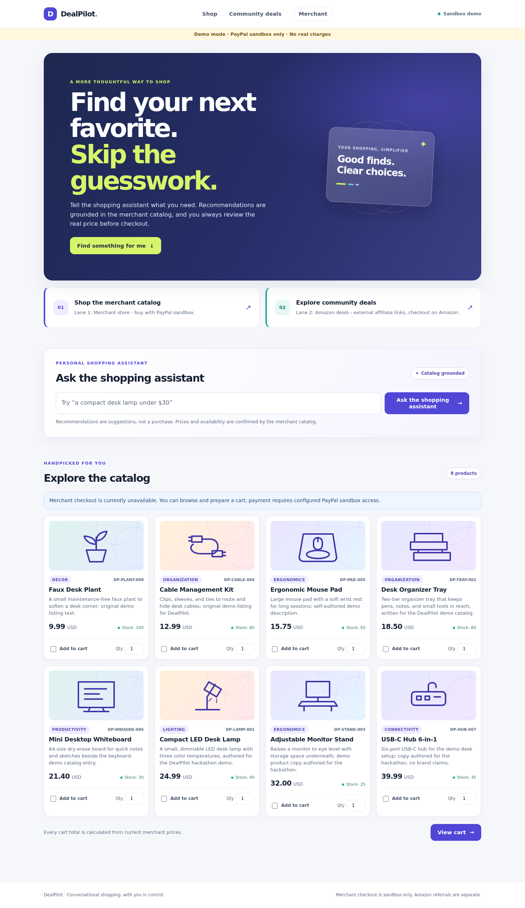

# DealPilotAI

Catalog-grounded shopping assistance with human-approved PayPal sandbox checkout. Built for shoppers comparing products and small merchants evaluating conversational commerce.

**Current status:** genuine Featherless inference passed six release scenarios on November 11, 2026. Real sandbox OAuth and order creation passed. Buyer-approved capture, genuine signed webhook delivery, final-candidate CI, and the public submission video remain release gates. See [release gates](docs/release/RELEASE_GATE_MATRIX.md) and [integration evidence](docs/release/INTEGRATION_EVIDENCE.md). This is not production payment software.

## Run locally

Use Python 3.14. A clean Python 3.14.9 installation of the pinned development requirements was verified. The repository license is [MIT](LICENSE).

```bash
git clone https://github.com/RafalW3bCraft/DealPilotAI.git
cd DealPilotAI
python3.14 -m venv .venv
source .venv/bin/activate
python -m pip install -r requirements-dev.txt
python -m playwright install --with-deps chromium
python scripts/run_web.py --offline
```

Open http://127.0.0.1:5000/shop. Offline mode ignores `.env`, disables external integrations, labels deterministic recommendations, and supports catalog selection, cart quotes, edits and expiration recovery. Payment is unavailable. No Telegram account, AI key, or PayPal account is needed for this profile.

## Configure real AI and sandbox checkout

```bash
cp .env.example .env
# Edit .env privately; never commit credentials.
python scripts/config_check.py --online
python scripts/ai_smoke.py
python scripts/ai_release_smoke.py
python scripts/run_web.py
```

Set `DEMO_MODE=false`, a private random `FLASK_SECRET_KEY` of at least 16 characters, `DASHBOARD_TOKEN`, and durable `COMMERCE_DATABASE_URL`. SQLite is sufficient for the local demonstration; PostgreSQL is exercised by separate integration tests. Set `APP_BASE_URL=http://127.0.0.1:5000` for local browser returns. Remote origins must use HTTPS. The application derives `/paypal/return` and `/paypal/cancel` from this configured origin, never from an untrusted Host header.

For AI, set `AI_PROVIDER=featherless` or `openai`, the corresponding private key, and a model accessible to that account. The verified model was `Qwen/Qwen3.8-27B` on Featherless. `AI_RESPONSE_FORMAT=auto` uses prompt-requested JSON on Featherless and JSON-object mode on OpenAI. The verified Featherless model returned empty content with JSON-object mode; prompt JSON succeeded. Both transports require strict server parsing and catalog validation. Timeouts default to 20 seconds and retries to one.

For payments, configure sandbox `PAYPAL_CLIENT_ID`, `PAYPAL_CLIENT_SECRET` and `PAYPAL_WEBHOOK_ID`. Live PayPal endpoints are refused. A sandbox merchant account and a separate sandbox personal buyer account are required. Open `/shop`, ask for a lamp and organizer, select products, review the server quote, follow PayPal approval, then inspect the verified receipt. Sign in at `/merchant/login` for merchant records. Tokens belong in the login form or bearer header, never URL parameters.

AI chooses and ranks SKUs and proposes quantities. Price, currency, availability and displayed commercial facts are server-authored from catalog data. The AI cannot capture a payment. Recommendations are alternatives; the proposed cart is independently checked against the whole budget. Unavailable inference is visibly labeled fallback.

## Recovery and webhooks

Pending orders have bounded automatic checks and manual refresh. Checkout replay returns the existing order reference, including after payment or quote expiry. An uncertain create does not create another payment: the merchant can verify the original PayPal ID against the stored quote and attempt references. Completed funds conflicting with a canceled/failed order remain recorded and visibly require review.

```bash
python scripts/retry_paypal_webhooks.py
python scripts/retry_paypal_webhooks.py --watch --interval 60 --limit 20
```

A genuine webhook requires a public HTTPS forwarder to the local `/webhooks/paypal` endpoint and matching sandbox webhook subscriptions. A simulator or mocked signature is not live evidence. See [integration evidence](docs/release/INTEGRATION_EVIDENCE.md).

## Verify

```bash
python -m compileall -q ai commerce paypal_checkout web core scripts tests
python -m pip check
python -m ruff check .
python -m pytest -q
python -m pytest --cov=ai --cov=commerce --cov=paypal_checkout --cov=web --cov-report=term-missing
python -m pip_audit -r requirements.lock
```

For PostgreSQL concurrency tests, provide `TEST_POSTGRES_URL` pointing to an expendable database named **dealpilot_test**. These tests truncate that database. CI provisions PostgreSQL 17 automatically; local runs without the variable explicitly skip those cases. Browser tests use a fake payment boundary and are not real capture evidence. Exact results and limitations are in the [test report](docs/release/TEST_REPORT.md).

## Product and architecture

- [Architecture and production boundaries](docs/ARCHITECTURE.md)
- [Audit and remediation matrix](docs/release/AUDIT.md)
- [Demo script and recording checklist](docs/DEMO_RUNBOOK.md)
- [Devpost draft and compliance](docs/DEVPOST_SUBMISSION.md)
- [Hackathon development history](HACKATHON_CHANGELOG.md)



The catalog and illustrations are demo assets, not an assertion of real physical inventory or fulfillment. Stock is a demo catalog snapshot with per-cart limits; concurrent warehouse reservations are a production prerequisite. Nothing is shipped and sandbox funds are not real charges.

The separate Telegram/Amazon lane is optional. It requires `ENABLE_EXTERNAL_AFFILIATE=true`; scraping additionally requires `DISABLE_UNVERIFIED_AMAZON_SCRAPING=false` and authorization to use the source. It does not turn Amazon items into merchant PayPal products. Legacy bot commands remain available through `python main.py bot` when configured. Web-only startup uses `scripts/run_web.py` and does not initialize Telegram.

No hosting is required by the hackathon rules. Judges can use the offline profile immediately, then configure their own sandbox/AI test environment. Free complete integration access has not been established for judges. No public demonstration video or Devpost submission is claimed.
