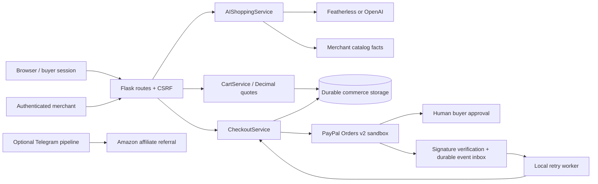

# Architecture and production boundary

## Mission and current system

Help shoppers find relevant merchant products while keeping product facts, cart arithmetic, ownership and payment authorization under deterministic server control. The current application is a single-merchant, USD, sandbox demonstration with a separate affiliate referral lane.

## Ownership and boundaries

`ai` owns provider selection, typed output, catalog grounding, relevant fallback and read-only tools. The model proposes SKU ranking and quantities; unrestricted model commercial prose is not displayed. `commerce` owns immutable quote snapshots, pricing policy, checkout state and persistence. `paypal_checkout` owns sandbox-only OAuth and Orders HTTP transport. `web` owns sessions, CSRF, authorization, request validation and view models. The legacy scheduler/pipeline owns optional affiliate discovery; both its execution entrypoints and the scraper enforce configuration flags.

The JSON merchant catalog is the current catalog source; its database copy supports reporting. Commerce records never use the legacy in-memory deals backend. Explicit offline fallback storage may support browsing/quotes, but cannot support payment capture. PostgreSQL uses its native UUID type; SQLite retains string quote IDs.

## Financial consistency

One stable request ID identifies each quote/buyer checkout. One persisted capture request ID identifies capture retries. Ownership is checked before replay. A compare-and-set claim prevents simultaneous capture callers. Verified capture persistence, paid attempt state and paid quote state commit in one database transaction. PostgreSQL row locking and SQLite immediate transactions serialize finalization. Terminal order conflicts retain verified financial evidence and an audit alert without inventing a paid receipt.

PayPal is authoritative for remote approval and capture. Ambiguous network outcomes remain reviewable. Creation recovery accepts an original order ID only after authoritative order identity, custom attempt ID, quote reference, amount and currency match. Verified webhooks enter a durable inbox, are claimed atomically, and can recover stale processing claims. External callbacks are configuration-derived.

## Production requirements

This repository does not implement a production merchant operation. Before real commerce: make PostgreSQL inventory authoritative; migrate catalog seed data without resetting stock; reserve stock atomically per order; release reservations only after resolving ambiguous payment outcomes; add managed/versioned migrations, a durable queue and monitored workers, operational user/role authentication, server-side revocation, shared rate limiting, HTTPS/trusted proxy configuration, encrypted backups and restore exercises, fulfillment, refunds, disputes, tax and accounting reconciliation, and an approved live-payment operating process.

Keep the existing service boundaries. Add those capabilities behind them rather than migrating the frontend framework or merging affiliate referrals into merchant checkout. Production readiness requires separate evidence for these gates; a successful sandbox capture is insufficient.

## HTTP interfaces

Checkout start accepts an owned quote ID and returns status, attempt_id, approve_url when available, and an owner-authorized order_url. Paid replay returns HTTP 200; failed/canceled/review outcomes return HTTP 409; HTTP 202 is reserved for unresolved active processing. Merchant recovery accepts paypal_order_id under merchant authentication and CSRF protection.

| Method | Route |
|---|---|
| GET | `/` |
| GET | `/deals` |
| GET | `/users` |
| GET | `/api/stats` |
| GET | `/api/deals` |
| GET | `/api/users` |
| GET | `/api/config` |
| GET | `/api/ready` |
| GET | `/api/health` |
| GET | `/shop` |
| GET | `/api/catalog` |
| GET | `/api/csrf` |
| POST | `/api/ai/recommend` |
| POST | `/cart/quote` |
| GET | `/cart` |
| POST | `/checkout/start` |
| GET | `/checkout` |
| GET | `/paypal/return` |
| GET | `/paypal/cancel` |
| GET | `/orders/<attempt_id>` |
| GET | `/orders/<attempt_id>/status.json` |
| POST | `/merchant/orders/<int:attempt_id>/recover` |
| GET, POST | `/merchant/login` |
| POST | `/merchant/logout` |
| GET | `/merchant` |
| POST | `/webhooks/paypal` |
